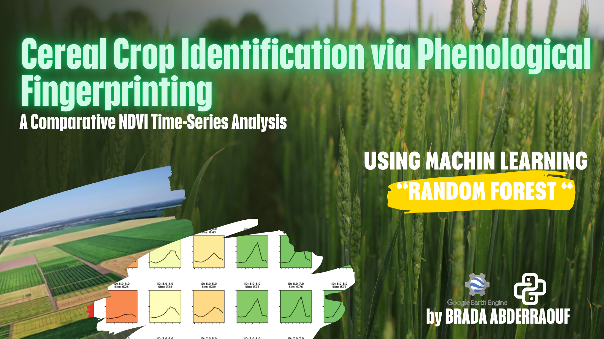
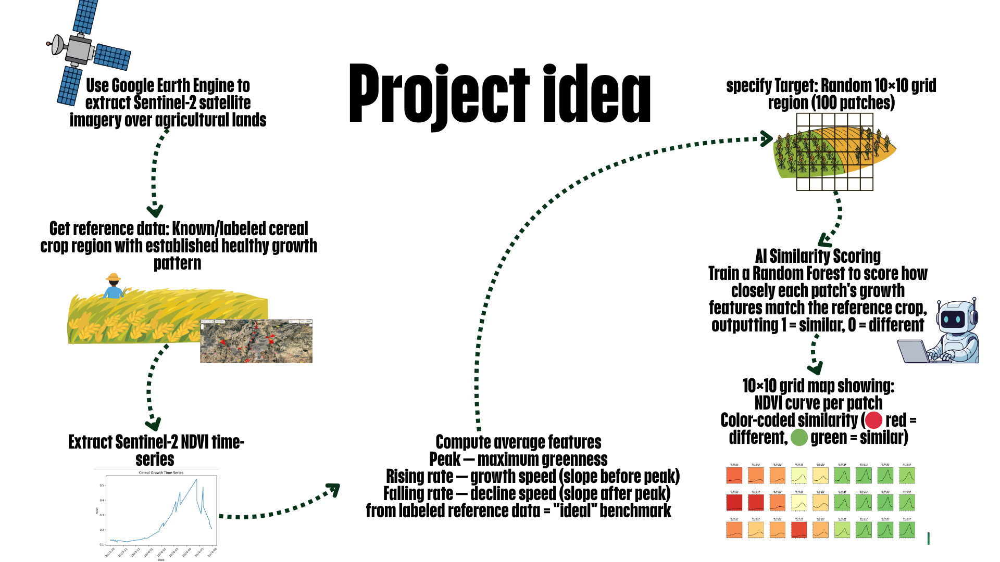
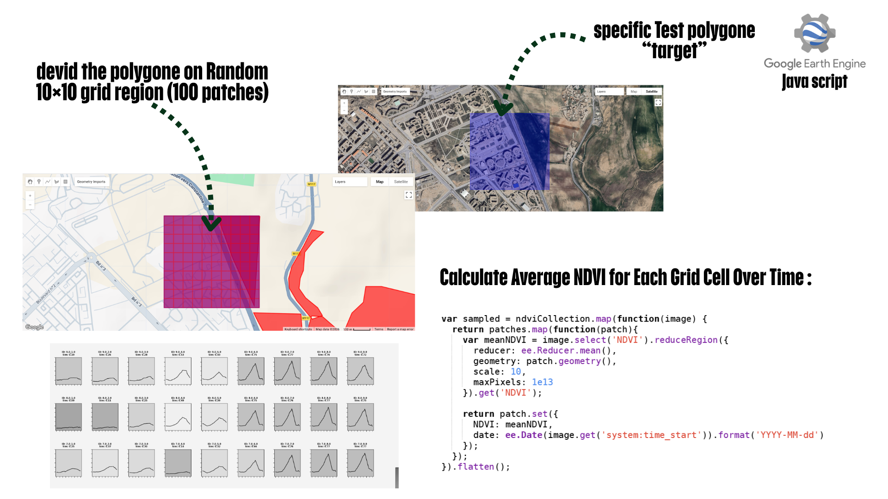

# 🌾 Cereal Crop Identification via Phenological Fingerprinting

**A comparative NDVI time-series analysis using Google Earth Engine, Python and Random Forest.**


<!-- TODO: add the cover slide as images/cover.png -->

## 📌 Overview

This project detects cereal-like vegetation by comparing the **growth pattern (phenological fingerprint)** of any target area to a known, labeled cereal reference.

1. Sentinel-2 imagery is processed in **Google Earth Engine** to build NDVI time series.
2. Three phenology features are extracted from the reference cereal fields: **peak**, **rising slope** and **falling slope**.
3. A target polygon is divided into a **10×10 grid (100 patches)**.
4. A **Random Forest** model scores how similar each patch is to the reference (1 = similar, 0 = different).
5. The result is a color-coded grid map with the NDVI curve of every patch.


<!-- TODO: add the "Project idea" slide as images/workflow.png -->

## 🛰️ What is NDVI?

NDVI (Normalized Difference Vegetation Index) measures the difference between near-infrared light (strongly reflected by vegetation) and red light (absorbed by vegetation):

```
NDVI = (NIR - RED) / (NIR + RED)
```

For Sentinel-2 this uses bands **B8** (NIR) and **B4** (Red). Over a season, NDVI follows the crop life cycle: low at planting, high at peak growth, dropping at harvest.

## 🔬 Method

### 1. Reference NDVI time series (Google Earth Engine, JavaScript)
- Labeled cereal fields in the study area (Sétif region, Algeria).
- Average NDVI per date, October 2023 → June 2024.
- Script: `gee/01_reference_ndvi_timeseries.js`


<!-- TODO: add the cereal growth time series plot -->

### 2. Phenology feature extraction (Python)
| Feature | Meaning |
|---|---|
| Peak | Maximum NDVI (maximum greenness) |
| Rising slope | Growth speed (linear regression before the peak) |
| Falling slope | Decline speed (linear regression after the peak) |

Code: `src/features.py`

### 3. Grid patches on the target polygon (Google Earth Engine)
- The target polygon is split into 10×10 patches.
- Mean NDVI is computed per patch and per date (scale = 10 m).
- Script: `gee/02_grid_patch_ndvi.js`


<!-- TODO: add the target polygon + grid screenshot -->

### 4. Random Forest similarity scoring (Python)
- Similarity target: `1 / (1 + Euclidean distance to the reference features)`, then min-max scaled and squared.
- Model: `RandomForestRegressor(n_estimators=100, random_state=42)`
- Predictions are clipped to `[0, 1]`.

Code: `src/similarity_model.py`

## 📊 Results

Green patches = similar to the reference cereal growth pattern. Red patches = different.

| Target area | Similarity grid |
|---|---|
|  |  |

<!-- TODO: add target_polygon.png and results_grid.png -->

## 📁 Repository structure

```
├── README.md
├── LICENSE
├── requirements.txt
├── .gitignore
├── gee/                 # Google Earth Engine scripts (JavaScript)
├── src/                 # Python modules
├── notebooks/           # Full analysis notebook
├── data/                # Exported NDVI CSV files
├── images/              # Figures used in this README
└── docs/                # Presentation slides (PDF)
```

## 🚀 How to run

1. **Google Earth Engine**: open the scripts in `gee/` in the [Code Editor](https://code.earthengine.google.com/), draw your reference and target polygons, and export the NDVI tables as CSV into `data/`.
2. **Python**:
   ```bash
   git clone https://github.com/<your-username>/<repo-name>.git
   cd <repo-name>
   pip install -r requirements.txt
   jupyter notebook notebooks/phenology_similarity_rf.ipynb
   ```
<!-- TODO: replace <your-username> and <repo-name> -->

## ⚠️ Limitations and future work

- The similarity labels are computed from the same features the model receives, so the Random Forest mainly learns a smooth version of the distance function. Future work: train on real labeled cereal / non-cereal patches and evaluate on held-out data.
- Only 3 features are used. Adding more (peak date, season length, NDVI integral) could improve separation.
- Cloud filtering and gap-filling of the time series can be improved.
- Test on more regions and several seasons.

## 🧰 Tech stack

Google Earth Engine (JavaScript) · Sentinel-2 · Python · NumPy · pandas · SciPy · scikit-learn · Matplotlib

## 👤 Author

**Abderraouf Brada**
National School of Nanosciences and Nanotechnology, Algeria
📧 abderraoufbrada.05@gmail.com

## 📄 License

MIT License. See [LICENSE](LICENSE).
